# Component catalog

Every entry has a title, description, source, integration notes, screenshot and a callable Codex skill. Screenshots are visual references; open the gallery to inspect motion and interaction. `hds-tech-text` is an upstream-install recipe, not a bundled component.

## Spotlight Hover

`$hds-spotlight-hover` · **component**

Cursor-following radial glow, card lift and violet border transition.

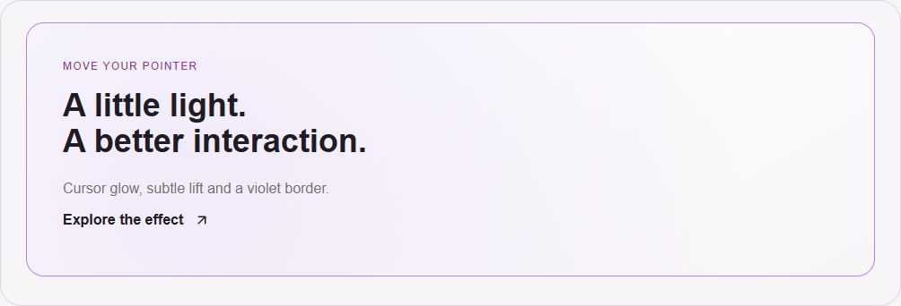

- [Skill](../skills/hds-spotlight-hover/SKILL.md)
- [Implementation](../src/components/SpotlightCard.tsx)
- Portfolio source: `src/components/SpotlightCard.tsx`
- Export: `SpotlightCard`

Independent implementation of the visual behavior. Fine pointers only; retain focus-visible and motion fallbacks.

## Illustrated Service Card

`$hds-service-card` · **component**

Service card composition combining a hover spotlight with miniature artwork.

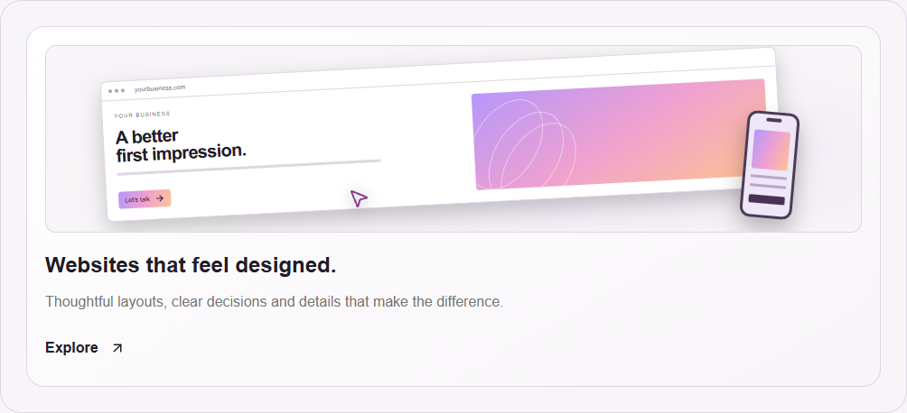

- [Skill](../skills/hds-service-card/SKILL.md)
- [Implementation](../src/components/Visuals.tsx)
- Portfolio source: `src/components/islands/CapabilitiesOverview.tsx`
- Export: `ServiceCard`

Expose title, description, link and illustration kind. Avoid nesting interactive controls inside links.

## Violet Pink Amber Palette

`$hds-gradient-palette` · **component**

Exact light/dark tokens and the signature 110-degree gradients.

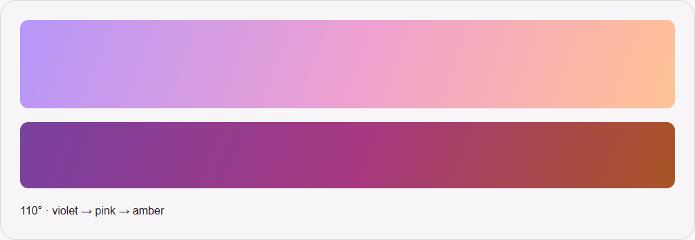

- [Skill](../skills/hds-gradient-palette/SKILL.md)
- [Implementation](../src/styles/tokens.css)
- Portfolio source: `src/styles/global.css`
- Export: `GradientText`

Text gradient: #7941a0 → #a73880 → #a95425. Surface gradient: #b697fa → #efa1d0 → #ffc293, stops 0%, 52%, 100%, angle 110deg. Scope tokens when the host uses other variables.

## Gradient Typography

`$hds-gradient-text` · **component**

Readable gradient text using the darker palette in light mode.

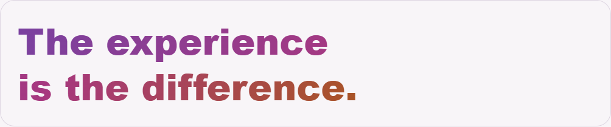

- [Skill](../skills/hds-gradient-text/SKILL.md)
- [Implementation](../src/components/Visuals.tsx)
- Portfolio source: `src/components/DesignBelief.astro`
- Export: `GradientText`

Use --accent-gradient for text, --accent-surface-gradient for fills. Keep text as semantic HTML.

## Gradient Pill Button

`$hds-gradient-button` · **component**

Rounded gradient CTA with arrow and brightness hover.

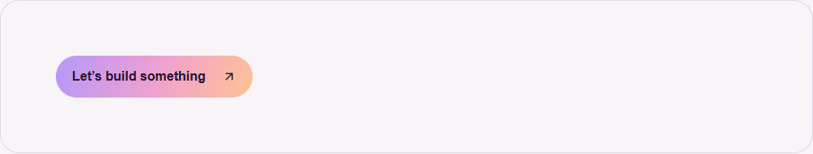

- [Skill](../skills/hds-gradient-button/SKILL.md)
- [Implementation](../src/components/Visuals.tsx)
- Portfolio source: `src/components/home/HeroSection.astro`
- Export: `GradientButton`

Use a real button for actions and an anchor for navigation. Keep the 52px control height and dark text.

## Ambient Gradient Glow

`$hds-ambient-glow` · **component**

Soft violet, pink and amber radial lighting behind artwork.

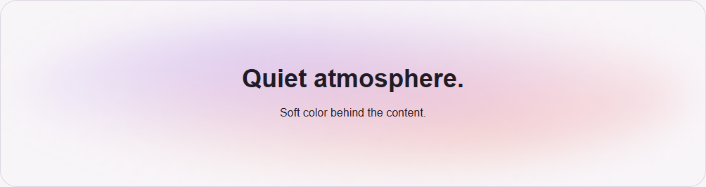

- [Skill](../skills/hds-ambient-glow/SKILL.md)
- [Implementation](../src/components/Visuals.tsx)
- Portfolio source: `src/components/home/HeroSection.astro`
- Export: `AmbientGlow`

Keep decorative layers behind content and noninteractive. Avoid blurring text.

## Technical Grid Surface

`$hds-grid-surface` · **component**

Subtle 24px grid for diagrams and illustration backgrounds.

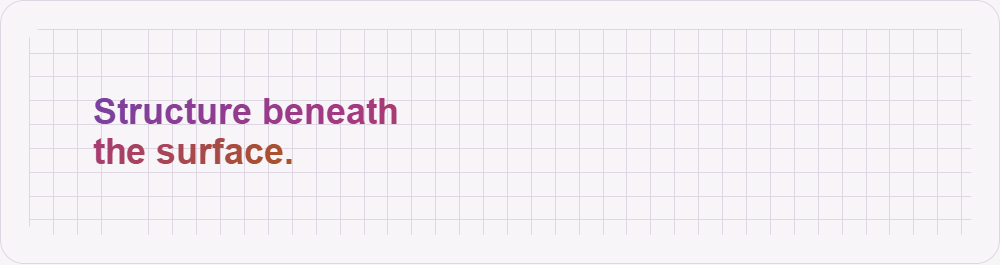

- [Skill](../skills/hds-grid-surface/SKILL.md)
- [Implementation](../src/components/Visuals.tsx)
- Portfolio source: `src/components/ServiceGraphic.tsx`
- Export: `GridSurface`

Keep grid contrast quiet; apply radial masks to decorative overlays when needed.

## Animated Robot Sphere

`$hds-robot-orb` · **component**

Procedural Three.js pearl sphere with autonomous gaze, blink and float.

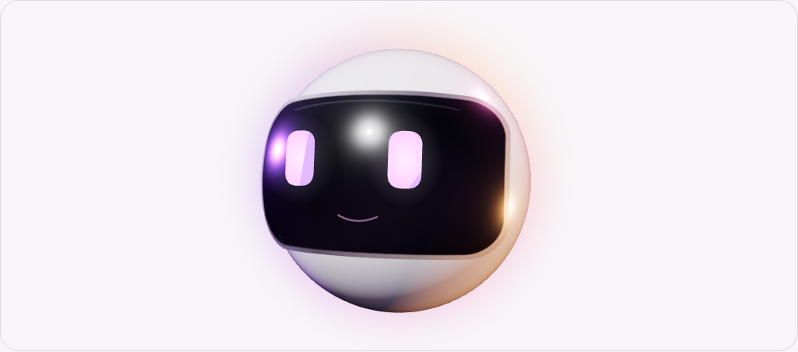

- [Skill](../skills/hds-robot-orb/SKILL.md)
- [Implementation](../src/components/RobotOrb.tsx)
- Portfolio source: `src/scripts/robot-orb.ts`
- Export: `RobotOrb`

Copy the renderer, fallback SVG and wrapper together. Preserve lazy loading, offscreen/hidden-tab pause, renderer disposal and motion preferences. No external 3D models required.

## Interactive Technical Text

`$hds-tech-text` · **upstream recipe**

ReactBits technical text with sweep, outlined glyphs and spring-return dragging.

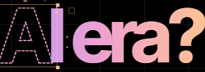

- [Skill](../skills/hds-tech-text/SKILL.md)
- [Implementation](../docs/tech-text.md)
- Portfolio source: `src/components/TechText.tsx`
- Export: `upstream`

Upstream-install recipe only. Do not copy ReactBits source into a redistributed component library. Install the current official TechText TS CSS registry component directly in the consuming application; keep static text, fine-pointer dragging, Arabic word shaping and reduced-motion fallback.

## Animated Line Mascot

`$hds-sketch-mascot` · **component**

Original robot line drawing with periodic blinking and changing gaze.

- [Skill](../skills/hds-sketch-mascot/SKILL.md)
- [Implementation](../src/components/ContactSketch.tsx)
- Portfolio source: `src/components/ContactSketch.astro`
- Export: `ContactSketch`

Support animated=false for compact logos. Keep decorative SVG aria-hidden and halt motion when requested.

## Website Service Illustration

`$hds-website-graphic` · **component**

Tilted miniature browser, phone and pointer that align on hover.

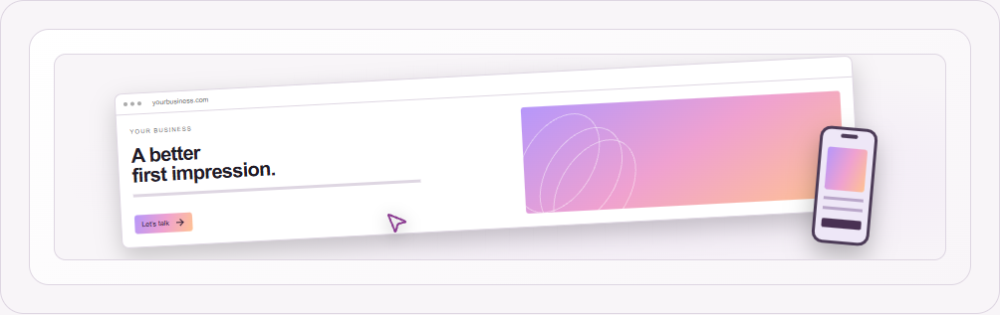

- [Skill](../skills/hds-website-graphic/SKILL.md)
- [Implementation](../src/components/ServiceGraphic.tsx)
- Portfolio source: `src/components/ServiceGraphic.tsx`
- Export: `ServiceGraphic`

Use kind="website" within data-ui="service-card" to activate the existing CSS hover behavior.

## Redesign Service Illustration

`$hds-redesign-graphic` · **component**

Layered before-and-after screens with hover transforms.

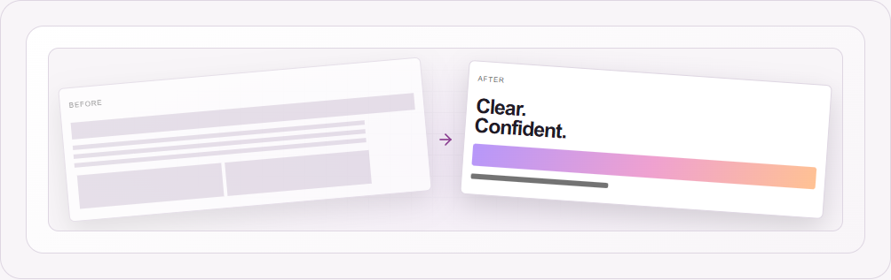

- [Skill](../skills/hds-redesign-graphic/SKILL.md)
- [Implementation](../src/components/ServiceGraphic.tsx)
- Portfolio source: `src/components/ServiceGraphic.tsx`
- Export: `ServiceGraphic`

Use kind="redesign" within data-ui="service-card".

## Assistant Service Illustration

`$hds-assistant-graphic` · **component**

Miniature knowledge documents and chat preview.

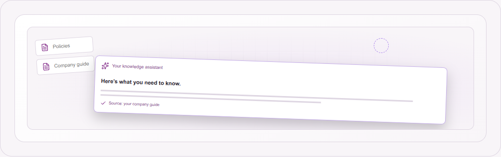

- [Skill](../skills/hds-assistant-graphic/SKILL.md)
- [Implementation](../src/components/ServiceGraphic.tsx)
- Portfolio source: `src/components/ServiceGraphic.tsx`
- Export: `ServiceGraphic`

Use kind="assistant" within data-ui="service-card".

## Dashboard Service Illustration

`$hds-dashboard-graphic` · **component**

Miniature dashboard whose chart bars respond on hover.

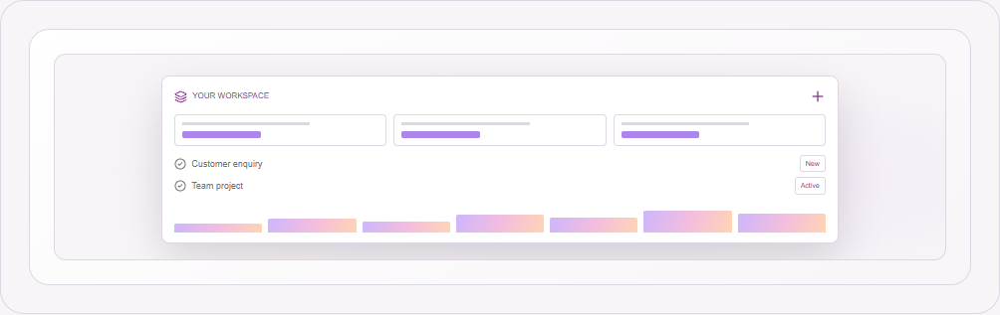

- [Skill](../skills/hds-dashboard-graphic/SKILL.md)
- [Implementation](../src/components/ServiceGraphic.tsx)
- Portfolio source: `src/components/ServiceGraphic.tsx`
- Export: `ServiceGraphic`

Use kind="dashboard" within data-ui="service-card".

## Product Service Illustration

`$hds-product-graphic` · **component**

Connected product nodes that shift subtly on hover.

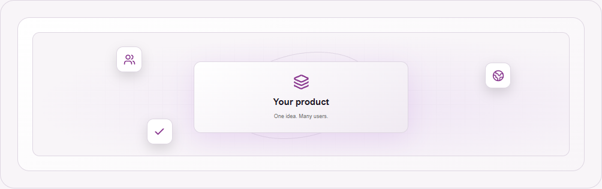

- [Skill](../skills/hds-product-graphic/SKILL.md)
- [Implementation](../src/components/ServiceGraphic.tsx)
- Portfolio source: `src/components/ServiceGraphic.tsx`
- Export: `ServiceGraphic`

Use kind="product" within data-ui="service-card".

## Browser Transformation

`$hds-browser-transform` · **component**

Original vector animation reorganizing a plain website into a polished layout.

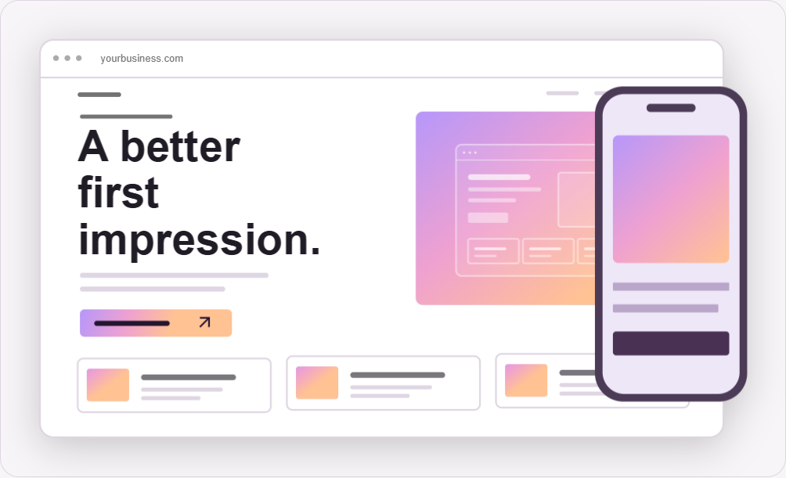

- [Skill](../skills/hds-browser-transform/SKILL.md)
- [Implementation](../src/components/DesignBrowser.tsx)
- Portfolio source: `src/components/DesignBrowser.astro`
- Export: `DesignBrowser`

Use the native Web Animations controller with the complete vector art. Preserve its 13s cycle and offscreen pause. SVG IDs must be unique per instance.

## Responsive Website Showcase

`$hds-responsive-showcase` · **component**

Authored desktop and phone website presentation with expandable studio details.

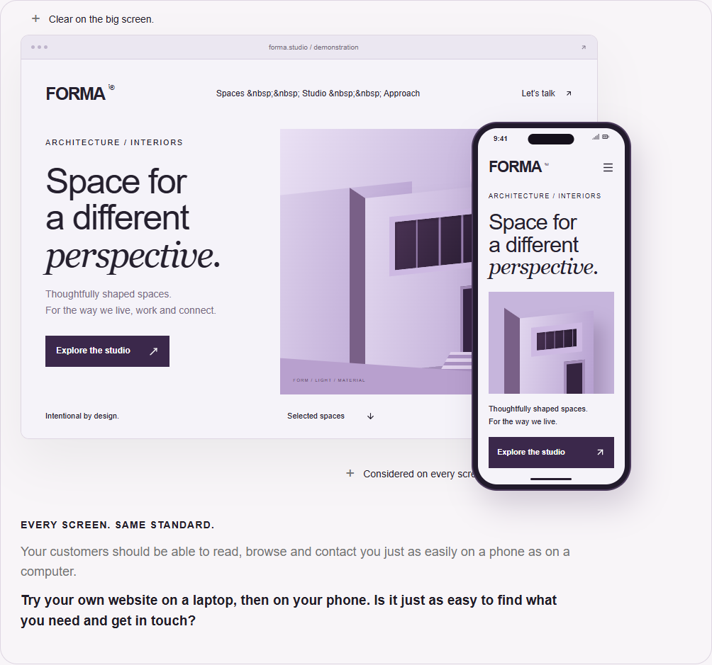

- [Skill](../skills/hds-responsive-showcase/SKILL.md)
- [Implementation](../src/components/WebsiteExperience.tsx)
- Portfolio source: `src/components/WebsiteExperience.astro`
- Export: `WebsiteExperience`

This is illustrative sample content; replace business copy for real products. Scope expandable details to each instance.

## Desktop Browser Frame

`$hds-browser-frame` · **component**

Rounded browser shell with chrome dots for product previews.

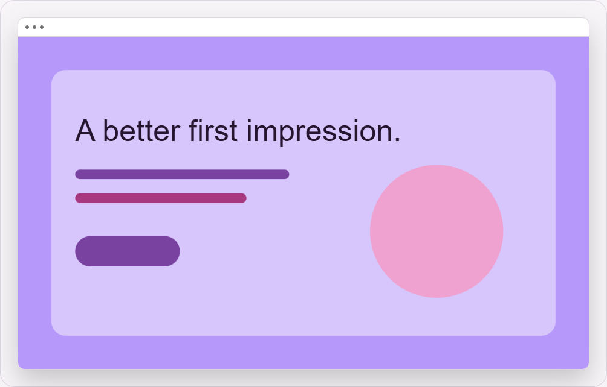

- [Skill](../skills/hds-browser-frame/SKILL.md)
- [Implementation](../src/components/Visuals.tsx)
- Portfolio source: `src/components/DeviceComparison.astro`
- Export: `BrowserFrame`

Accept arbitrary children and a descriptive label. Preserve contained width and clipping.

## Phone Device Frame

`$hds-phone-frame` · **component**

Dark rounded phone shell and tall clipped screen.

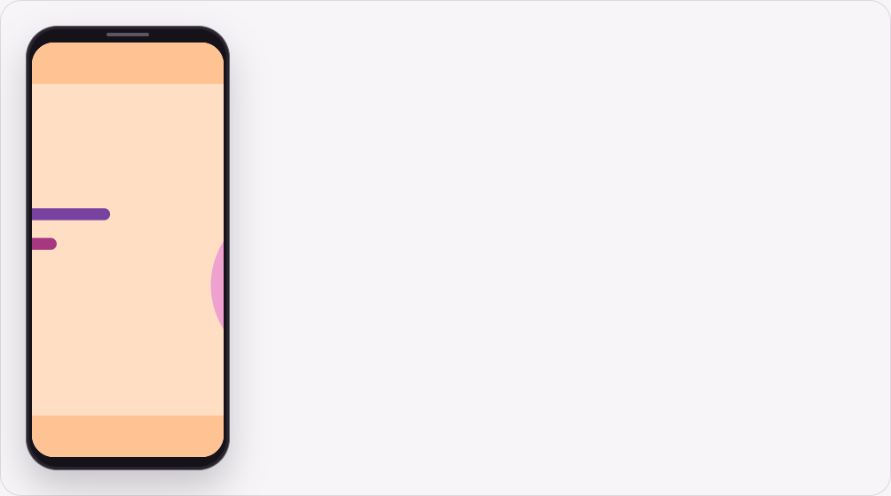

- [Skill](../skills/hds-phone-frame/SKILL.md)
- [Implementation](../src/components/Visuals.tsx)
- Portfolio source: `src/components/DeviceComparison.astro`
- Export: `PhoneFrame`

Use the 375/812 screen ratio, 36px outer radius, and 25px inner radius.

## Before After Device Comparison

`$hds-device-comparison` · **component**

Toggle synchronized desktop and mobile previews of two designs.

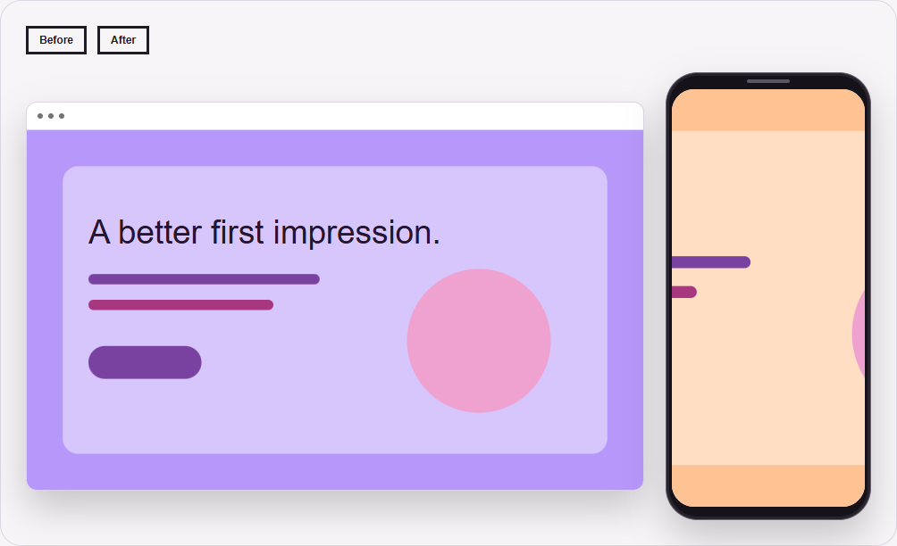

- [Skill](../skills/hds-device-comparison/SKILL.md)
- [Implementation](../src/components/Interactions.tsx)
- Portfolio source: `src/components/DeviceComparison.astro`
- Export: `DeviceComparison`

Supply before and after desktop/mobile images. Keep aria-pressed state and meaningful alt text.

## Scroll Reveal

`$hds-scroll-reveal` · **component**

Once-per-mount 24px rise and fade for content entering the viewport.

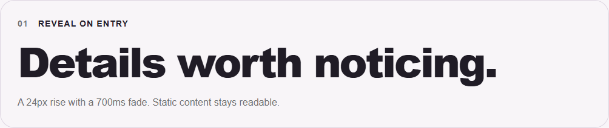

- [Skill](../skills/hds-scroll-reveal/SKILL.md)
- [Implementation](../src/components/Interactions.tsx)
- Portfolio source: `src/scripts/homepage.ts`
- Export: `Reveal`

Static HTML stays visible before hydration and for reduced motion. This uses native Web Animations instead of the site GSAP reveal; duration remains 700ms.

## Scroll Progress Timeline

`$hds-process-timeline` · **component**

Four-stage process with a scroll-drawn gradient connector and mobile vertical layout.

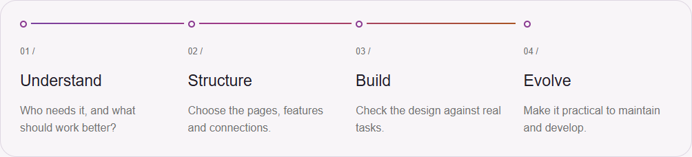

- [Skill](../skills/hds-process-timeline/SKILL.md)
- [Implementation](../src/components/Interactions.tsx)
- Portfolio source: `src/components/home/ThinkingProcess.astro`
- Export: `ProcessTimeline`

Retain GSAP ScrollTrigger scrubbing and matchMedia cleanup. Default geometry is four stages; adjust connector width for other counts.

## Project Preview Card

`$hds-project-card` · **component**

Editorial project image card with subtle hover zoom.

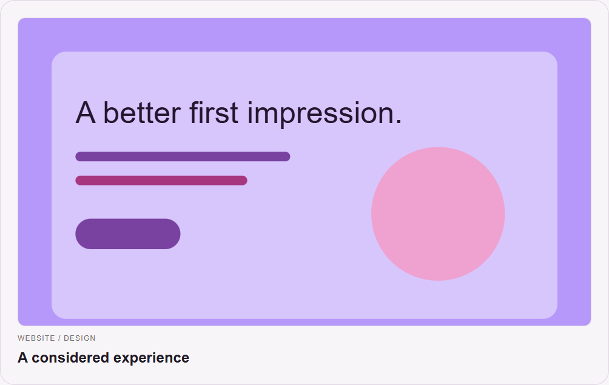

- [Skill](../skills/hds-project-card/SKILL.md)
- [Implementation](../src/components/Visuals.tsx)
- Portfolio source: `src/components/ProjectCard.astro`
- Export: `ProjectCard`

Supply project content and images through props. Preserve 1200/645 media ratio and lazy loading.

## Snap Carousel

`$hds-carousel` · **component**

Horizontal snap track with previous/next controls, count and RTL support.

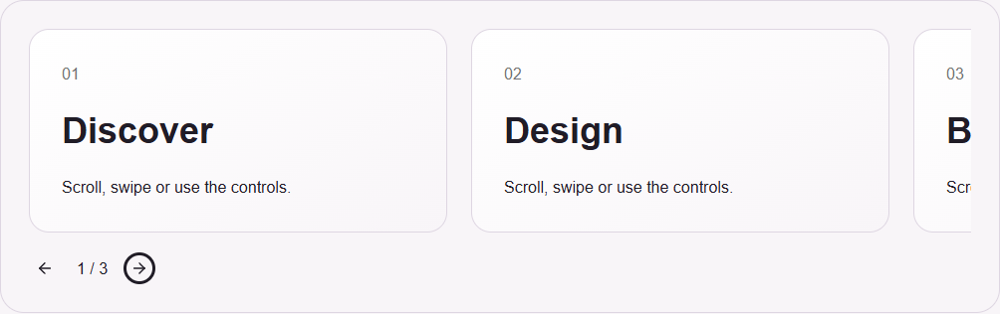

- [Skill](../skills/hds-carousel/SKILL.md)
- [Implementation](../src/components/Interactions.tsx)
- Portfolio source: `src/scripts/carousel.ts`
- Export: `Carousel`

Use bounding-box distances for direction-aware scroll targets; preserve disabled controls and instant reduced-motion scrolling.

## Editorial Section Heading

`$hds-section-heading` · **component**

Numbered overline and large tightly spaced display typography.

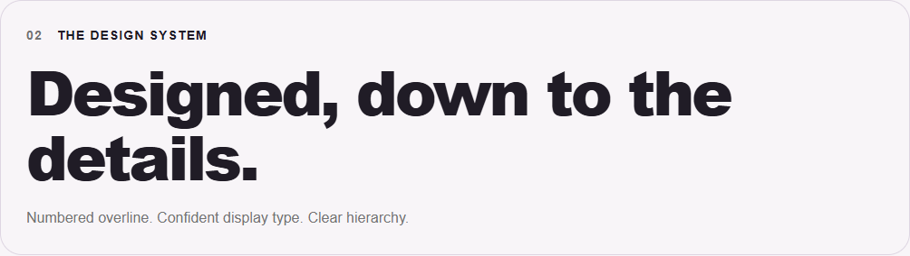

- [Skill](../skills/hds-section-heading/SKILL.md)
- [Implementation](../src/components/Visuals.tsx)
- Portfolio source: `src/components/SectionHeading.astro`
- Export: `SectionHeading`

Preserve display font, weight 800, -0.045em tracking and responsive clamp. Match host heading hierarchy.

## Arrow Link Hover

`$hds-arrow-link` · **component**

Text link whose northeast arrow shifts on hover.

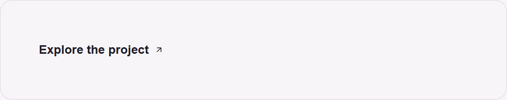

- [Skill](../skills/hds-arrow-link/SKILL.md)
- [Implementation](../src/components/Visuals.tsx)
- Portfolio source: `src/components/CaseStudyButton.astro`
- Export: `ArrowLink`

Maintain 44px target height and mark the icon decorative.

## Light Dark Theme Tokens

`$hds-theme-tokens` · **component**

Semantic colors and an optional theme toggle for the portfolio palette.

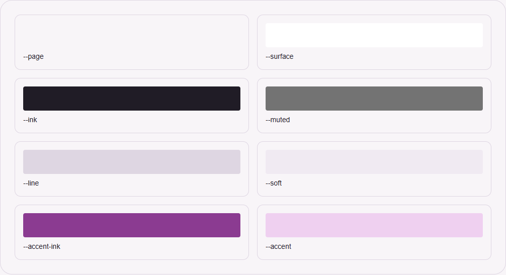

- [Skill](../skills/hds-theme-tokens/SKILL.md)
- [Implementation](../src/components/Interactions.tsx)
- Portfolio source: `src/styles/global.css`
- Export: `ThemeToggle`

The example toggle changes html data-theme and persists hds-theme. Do not override existing host theme control; use tokens as the visual reference.

## Violet Contribution Heatmap

`$hds-contribution-heatmap` · **component**

Seven-row activity chart with a five-step violet intensity scale.

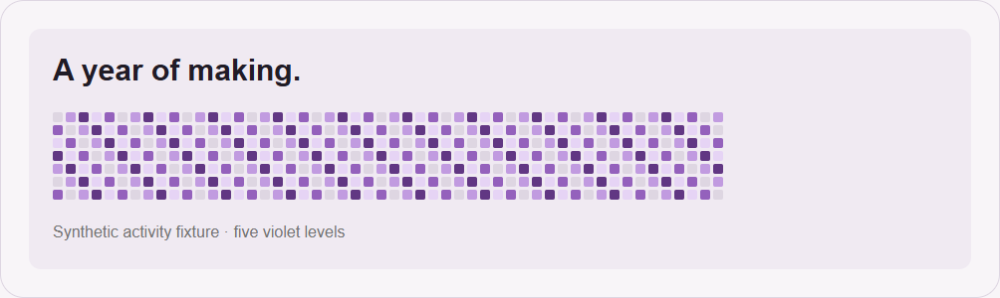

- [Skill](../skills/hds-contribution-heatmap/SKILL.md)
- [Implementation](../src/components/Interactions.tsx)
- Portfolio source: `src/components/GithubContributions.astro`
- Export: `ContributionHeatmap`

Accept caller data rather than bundled personal GitHub activity. Each week is seven intensity values from 0 to 4.

## Connected Product Diagram

`$hds-product-system` · **component**

Input, core and output architecture figure with a gradient connection line.

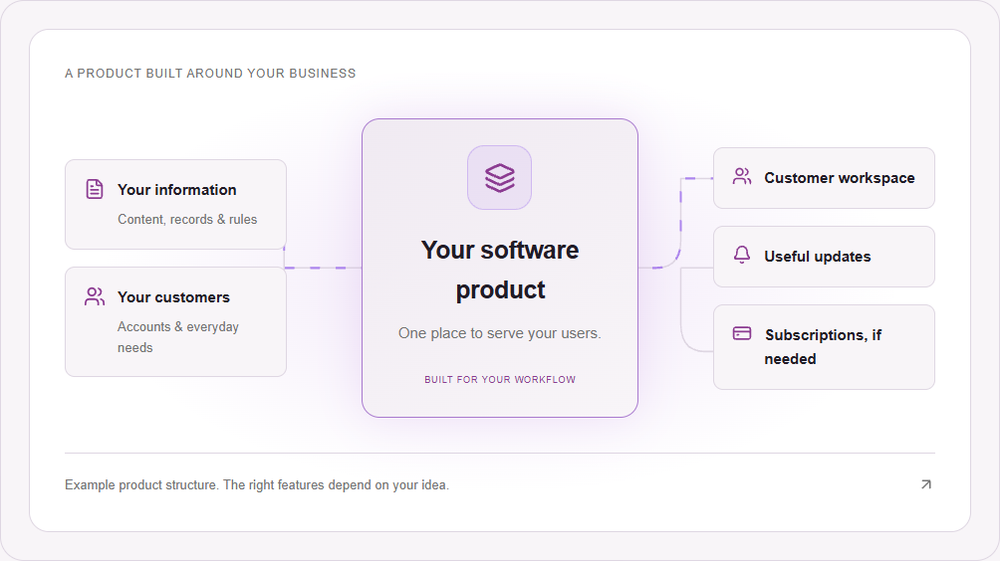

- [Skill](../skills/hds-product-system/SKILL.md)
- [Implementation](../src/components/ProductSystem.tsx)
- Portfolio source: `src/components/ProductSystem.astro`
- Export: `ProductSystem`

React adaptation of the static diagram. The original site scroll-scrubbed the connector; this exported diagram is static and should be animated only when requested.

## Grounded Chat Interface

`$hds-chat-demo` · **component**

Sample knowledge sidebar, chat bubbles, suggested questions and expandable citations.

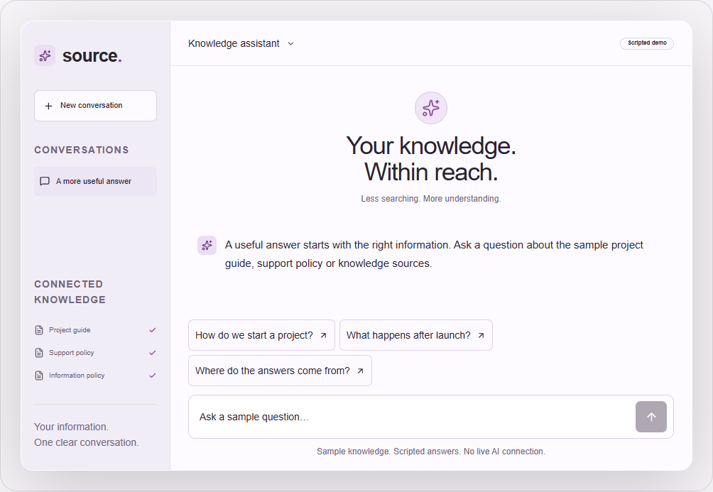

- [Skill](../skills/hds-chat-demo/SKILL.md)
- [Implementation](../src/components/ChatAssistantDemo.tsx)
- Portfolio source: `src/components/islands/ChatAssistantDemo.tsx`
- Export: `ChatAssistantDemo`

Local prepared-answer demonstration; no AI backend is included. Replace knowledge and messaging transport for production. Retain reset, busy state and source disclosure.

## Interactive Workspace Dashboard

`$hds-dashboard-demo` · **component**

Sample sidebar, metrics, searchable sortable table and record dialog.

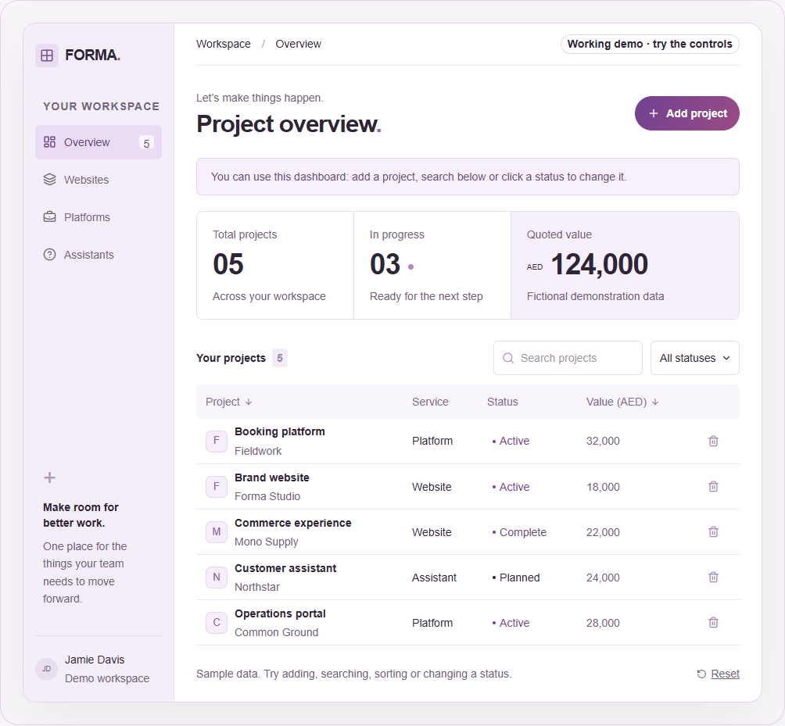

- [Skill](../skills/hds-dashboard-demo/SKILL.md)
- [Implementation](../src/components/DashboardDemo.tsx)
- Portfolio source: `src/components/islands/DashboardDemo.tsx`
- Export: `DashboardDemo`

Local sample data only. The original uses React state/manual table logic; when extending in a real app prefer TanStack Table/Query, React Hook Form with Yup, date-fns and Zustand when warranted.

## Rounded UI Primitives

`$hds-ui-primitives` · **component**

Portfolio buttons, badges, inputs, labels and accessible Radix dialog.

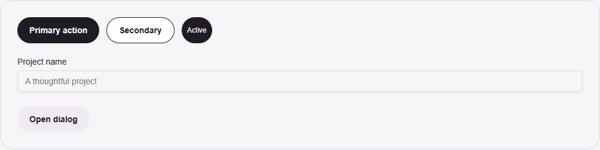

- [Skill](../skills/hds-ui-primitives/SKILL.md)
- [Implementation](../src/components/ui/button.tsx)
- Portfolio source: `src/components/ui/button.tsx`
- Export: `Button`

Preserve Radix keyboard/focus behavior and shadcn MIT attribution. If the host already has daisyUI or shadcn controls, adapt styling instead of replacing its component system.
